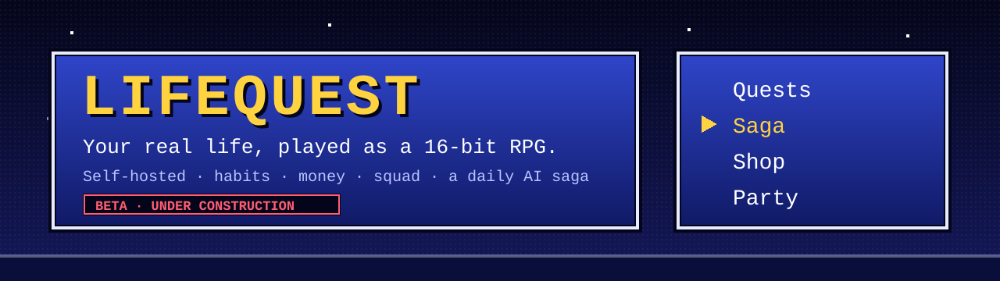
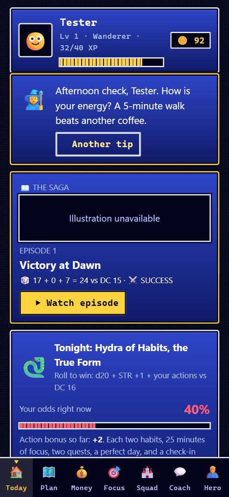
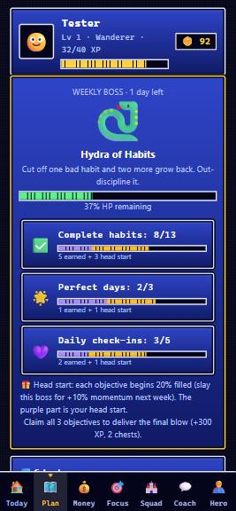
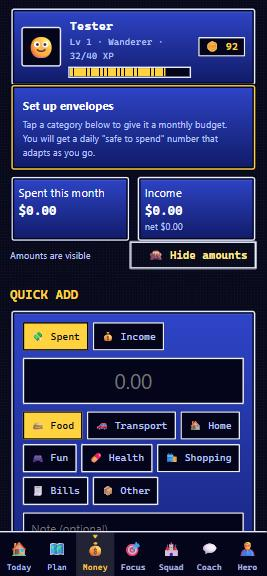
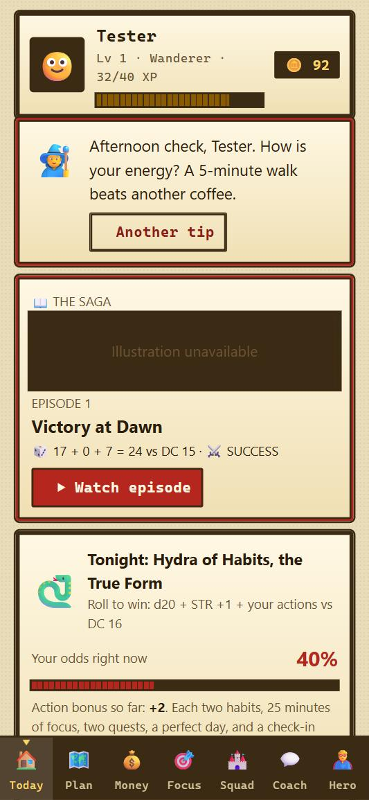

<p align="center"></p>

<h1 align="center">LifeQuest</h1>
<p align="center"><b>A self-hosted life coach that plays like a classic turn-based JRPG.</b><br>Habits, tasks, money and planning on your phone, a party of friends, and a daily AI-written D&amp;D episode starring your hero.</p>
<p align="center">
  
  
  
  
  
</p>

<p align="center">
  
  
  
  
</p>

> ## 🚧 Under construction: beta software
> LifeQuest is **in active development and in beta**. Features change often, some things are unfinished or untested on real hardware (see [docs/OPEN-ITEMS.md](docs/OPEN-ITEMS.md)), and the UI is mid-way through a retro-RPG redesign ([docs/UI-REFRESH.md](docs/UI-REFRESH.md)). Expect rough edges and breaking changes, and keep backups of your data (Hero → *Export backup*). It is built for self-hosting on a home network, not for exposure to the public internet. Issues and feedback are welcome.

An installable phone app (PWA) that turns your life into an RPG. No accounts, no cloud, no dependencies. Needs Node 18+.

## The party menu

| Command | What it does |
|---|---|
| **Town (Today)** | Your day at a glance: daily rituals, next quest, check-in, time left, tonight's Saga odds |
| **Quests (Plan)** | Tasks and a time-aware plan instead of a calendar grid, plus the weekly boss and its objectives |
| **Shop (Money)** | Envelope budgeting, quick spend logging, safe-to-spend number, CSV import. Amounts can be hidden |
| **Dojo (Focus)** | Focus timers as duels against bosses |
| **Guild (Squad)** | Opt-in friend leaderboard, cheers, shared raid bosses, squad challenges, monthly league |
| **Sage (Coach)** | A gentle coach with tips and a daily journal prompt, grounded in habit research (see [docs/RESEARCH.md](docs/RESEARCH.md)) |
| **Status (Hero)** | Six stats, achievements, rewards you define yourself, and the Look settings (16-bit or Classic, Night or Daylight) |
| **The Saga** | Every morning, yesterday's real actions become a D&D-style episode with a d20 roll against the weekly boss |

Everything runs on your own machine, saves instantly on the phone, and works offline.

## Roadmap

The look is being rebuilt as a "16-bit Saga" in phases (plan: [docs/UI-REFRESH.md](docs/UI-REFRESH.md)). Done: the theme layer, component restyle, and the Final Fantasy-style main menu and bottom bar. The Saga tonight-forecast shows hit chance and tappable ways to raise it. The Saga plays as a turn-based battle scene. Level-ups, perfect days and boss hits have their own moments, and Status is a proper JRPG screen. Known gaps are tracked in [docs/OPEN-ITEMS.md](docs/OPEN-ITEMS.md).

## The Saga (daily anime/D&D episode)

Turn it on in the app (Today → *Begin the Saga*). Every morning your hero's **real actions from yesterday** become an episode: a story written by a local AI, with an illustration.

- **It works like D&D.** Each day has an encounter against that week's boss, stronger every day (DC 10 on Monday up to DC 16 on Sunday). The d20 is rolled from a fixed seed, so it can't be re-rolled. Your real actions are the modifiers: ability level, habits done, focus minutes, quests, perfect days, a check-in. The Today screen shows your odds for tonight rising as you act.
- **Never punishing.** Misses are setbacks that become training montages, a natural 1 is a comic mishap, and a day with no actions is a calm campfire rest.
- **Your hero's gear grows with your level**, so XP visibly pays off in the pictures.
- **Private.** Everything is generated by models on your own PC. Journal text and money amounts are never used. You can turn habit names off in Hero → The Saga.
- **Needs** Ollama (storyteller) and optionally Stable Diffusion WebUI (pictures). Without them you still get a short template story.
- **Verified end to end** on a real run: local Nova story plus a local Stable Diffusion portrait, played as the battle scene.
- **Sharing the GPU.** The Saga only starts a model when enough GPU memory is genuinely free, and otherwise waits, so it won't disturb other apps. It starts Stable Diffusion on demand and shuts it down when idle.

Configuration lives in `data/config.json` (or environment variables):

```json
{ "storyModel": "nova-samantha-v1", "sdDir": "C:/path/to/stable-diffusion-webui", "sdModel": "CyberRealisticPony_V18.0_F16", "sdIdleMinutes": 10 }
```

Image backend: set `"imageBackend": "comfy"` to paint through ComfyUI instead of the Stable Diffusion WebUI, with `comfyDir` (your ComfyUI folder), `comfyModel` (default `animagine-xl-4.0-opt.safetensors`, an anime SDXL model), `comfyUrl`, `comfySteps`, `comfyCfg`. The Saga starts ComfyUI on demand (loopback only) and stops it when idle, only if it started it. Other keys: `sdStyle` (`cinematic` by default, or `anime` for flat-colour cel-shaded art; compare them with `node tools/style-test.js`), `storyUrl` (default Ollama at http://127.0.0.1:11434), `sdUrl`, `sdSteps`, `storyMinFreeMb` (18500), `sdMinFreeMb` (9000), `gpuWaitMinutes` (360), `dailyEpisodes`, `dailyImages`.

## Notifications and nudges

Turn on **Hero → Reminder settings** (opt-in), then push. LifeQuest can reach you even when the app is closed, using your own server (no third-party service beyond the browser's push gateway). Besides task, habit, bill and check-in reminders, there are three optional **Nudges** (Hero → Nudges):

- 📖 **Morning:** your hero's story from yesterday is waiting
- ⚔️ **Evening:** tonight's boss odds, and how much one more ritual raises them
- 🔥 **Evening:** a streak of 3+ days you can still save tonight (never guilt-based)

Everything respects quiet hours, a daily cap, rest mode and snooze. Tapping a notification opens the right screen, and the app icon shows how many rituals are left today (where the browser supports the badge API). True home-screen widgets need a native wrapper, which is on the roadmap.

Push needs HTTPS. Set `publicUrl` in `data/config.json` (or `LIFEQUEST_PUBLIC_URL`) to your HTTPS address, for example one made with `tailscale serve --bg --https=443 http://127.0.0.1:4747`, and the `/phone` page will list it first.

## Multiple users

Yes. Everyone you invite gets their **own private profile** (no email or password): they scan the QR on `http://localhost:4747/phone`, which signs their device in and shows the welcome screen where they pick a name. Each person has a separate save file, and only the squad board (name, avatar, level, XP, streak, focus minutes) is shared, and only if they opt in.

- **Privacy:** other players only ever see a one-way public ID. Nobody can read another person's journal, money or habits. Checked by an automated two-user test.
- **Inviting:** the QR/link carries the shared access token, so anyone who scans it can join. Only show it to people you want to invite. To cut everyone off, delete `data/token.txt` and restart; people then need a new link.
- **Capacity:** the server accepts up to 25 profiles by default (`MAX_PLAYERS=40 node server.js` to change).
- **Your own second device:** it would otherwise be a separate profile. Use Hero → Your devices → *Link another device* and scan that QR on the other device.
- Friends away from your Wi-Fi need to be on your Tailscale network.

## Quickest phone setup

On the PC that runs the server, open **http://localhost:4747/phone**. It shows QR codes (home Wi-Fi and Tailscale); scan one with your phone camera, then use *Add to Home screen*. That page is only served to the PC itself because it contains your access token. The server starts automatically at Windows login via a hidden launcher in your Startup folder (LifeQuest.vbs).

## Run it

```
node server.js          # or double-click start.bat
```

It prints a **Phone** link like `http://192.168.1.20:4747/#token=AbC123…`. On first run it generates an access token (saved in `data/token.txt`) because your money lives here. Opening the Phone link once signs that device in; after that the plain address works.

## Put it on your phone

1. **Same Wi-Fi (quick start):** run the server, open the Phone link in your phone's browser. When Windows asks, allow Node.js on **private** networks.
2. **Install it as an app (recommended):** installing, offline mode and the home-screen icon need **HTTPS**. With Tailscale on the PC and phone:
   - `tailscale serve --bg 4747`
   - open the `https://<pc-name>.<tailnet>.ts.net/#token=…` address on the phone once
   - Android Chrome: ⋮ → *Install app*. iPhone Safari: Share → *Add to Home Screen*.
   - Note: `tailscale serve` is reachable by everyone on your tailnet; the access token still protects your data.
3. **Always on:** the app only works while the PC runs the server. Put a shortcut to `start.bat` in `shell:startup`, or run it on a Raspberry Pi / spare PC / NAS.

The app also works offline on the phone and syncs when the server is reachable.

## Your data

- Everything is saved on the phone instantly (works offline).
- When the server is reachable it also syncs to `data/players/<your-id>.json` (with a rolling backup). The newest save wins, so phone and PC stay in step.
- Settings → *Export backup* downloads a JSON file any time.

## Squad: friends, leaderboard, raids

Friends use **your** server (share the Tailscale/HTTPS link). Everyone gets a private save file, and the **Squad** tab lets each person opt in to:

- **Leaderboard**: This week / All-time / Streak / Focus, with a 👑 for last week's champion.
- **Cheers** 👏: send a friend +3 🪙 (you get +2 🪙, up to 5 a day).
- **Squad Raid**: a co-op boss whose HP scales with the squad, and every XP anyone earns that week is damage. Clear it together for loot.

Only name, avatar, level, XP, streak and focus minutes are shared. Never habits, journal or chat. Scores are on the honor system. Rename it with `SQUAD_NAME="Team Awesome"`.

## Squad challenges

Anyone in the squad can throw down a challenge (XP, focus minutes, habit check-ins, quests, journal entries or active days, over 3, 7 or 14 days). Scores are tracked automatically. When it ends: 🥇 100 XP + 100 🪙 + trophy, 🥈 50, 🥉 25, and **everyone who finishes gets 15 XP + 15 🪙**.

## Monthly league

Six divisions (🥉 Bronze → 🔱 Legend). On the 1st, last month is judged: finish in the top third with 100+ XP to be promoted (solo players need 600+); under 50 XP, or the bottom third of 3+ active players, drops you a division. Promotion pays coins and a chest; the monthly champion gets 🏅 and a trophy; everyone who played gets coins. Open the app in the first days of a month so results are counted.

## Stakes (optional, off by default)

Turn on in Hero → Settings → *Loss-framed stakes*. Then, per stake: pick a 7-day goal (one habit, or any N habits a day) and move 10–100 coins into a pot. Each missed day loses a seventh of it; keep every day and get it all back **+10%** and 40 XP. One free shield day. Withdrawing early forfeits 25% of what's left. Play-money coins only.

## Money (the Vault) and Plan

- **Money:** 2-tap spending/income logging, category envelopes that behave like health bars, a daily **"safe to spend"** number, recurring bills, a savings hoard, no-spend days, insights, CSV export. Overspending never costs XP. First open each month rewards the envelopes you kept under budget.
- **Plan:** a horizon (Overdue / Today / This week / Later / Someday) instead of a calendar grid, with bills mixed in, a ⭐ "most important thing" bonus, and an energy-aware *Next up* on Today.
- Money data stays in your own save file and is never shown on the squad board.

## Time, reminders, import and rest

- **Timeline:** give a quest a start time and duration and it appears on the Plan tab's timeline (now-line, free gaps, overlap warnings). Quests can repeat daily / weekdays / weekly. One tap moves all overdue items to today.
- **Reminders:** opt-in in Settings, capped per day, with quiet hours and shame-free wording. They fire while the app is open or recently active (true closed-app push is on the roadmap).
- **Bank CSV import:** Money → Import bank CSV. Duplicates are skipped and auto-category rules are editable. No bank logins involved.
- **Rest mode** pauses streak penalties and stakes. **Graduate** a habit once it is automatic. **Calm mode** turns off confetti.
- See [docs/WISHLIST.md](docs/WISHLIST.md) for the research-backed list of what to build next.

## More features (wish-list round)

- **Habits:** consistency rhythm ("5/7 this week"), "N× per week" habits with weekly streaks, welcome-back screen with a **lite week**, private **patterns** (how habits relate to your mood), a **skill tree** (1 point per level), graduating automatic habits.
- **Plan:** imports your calendar (.ics, including repeating events), shows events and quests on one timeline, ⏰ reschedule, **Fit my day** (slots quests into free gaps, padded by how long things really take you), ▶ 5-minute start from any quest, "tiny first step", time left today.
- **Reminders:** snooze, per-item mute, escalation if a block was missed. **True push when the app is closed:** Hero → Reminder settings → *Turn on* (needs your HTTPS link; on iPhone add the app to your Home Screen first). The server sends reminders itself using Web Push. Nothing goes to any third-party service except your phone's own push gateway (Google/Apple/Mozilla). Optional: `VAPID_SUBJECT=mailto:you@example.com`.
- **Money:** real envelopes (rollover, move money, *To be budgeted*), irregular-income mode with a tax reserve, split transactions, repeating-charge detection with price-increase flags, month-over-month comparison, net worth trend, hide-amounts toggle.
- **Life:** weekly review, squad **focus rooms** (body doubling: +10% XP; only "focusing" is shared, never what you work on), **app lock PIN**, daily server **snapshots** you can restore.
- Tests: `node tools/test-push.js` checks the push encryption against the official RFC 8291 test vector.

## Science

Features are built on habit-formation research: grace-day streaks, if-then cues, automaticity ratings, WOOP planning, fresh-start resets. See [docs/RESEARCH.md](docs/RESEARCH.md) (also in-app: Hero → *The science behind this app*).

## Weekly boss quest

Every Monday a new themed boss spawns (Hydra of Habits, Doom Scroller, Lich of Lethargy…) with 3 objectives that **track automatically**. Claim each for +60 XP, then deliver the final blow for +300 XP, 2 chests and a trophy for your cabinet. Each objective starts 20% filled (a research-backed "head start"), plus 10% more if you slew last week's boss.

## Access token

Generated automatically into `data/token.txt`. Set your own with `LIFEQUEST_TOKEN=...`, or turn it off with `LIFEQUEST_TOKEN=off` (not recommended). If a device is ever asked for it, paste it in.

## Optional: real AI coach

Point it at any OpenAI-compatible endpoint, such as local Ollama, so your chats never leave your machine:

```
$env:LLM_URL="http://localhost:11434/v1/chat/completions"; $env:LLM_MODEL="llama3.1"; node server.js
```
Without it, the Coach tab uses a built-in scripted coach.

## What's in it

| | |
|---|---|
| **Today** | Coach tip, mood/energy check-in, habits with streak multipliers, Perfect Day bonus + chest |
| **Quests** | One-off tasks with XP, and a 🎲 random side-quest roller |
| **Focus** | Pomodoro as boss fights: time = damage, defeat bosses for chests (survives screen lock) |
| **Coach** | Quick-prompt coaching, optional AI chat, daily reflection prompts + journal |
| **Hero** | 6-stat radar, 12-week heatmap, weekly summary, 20 achievements, avatar unlocks, **reward shop** where you spend coins on real-life treats you define |
| Extras | Daily login bonus, loot chests (rare/legendary drops), sounds, haptics, confetti, level titles |

Change the port with `PORT=9000`. Regenerate icons with `node tools/make-icons.js`.


## License

[MIT](LICENSE). Contributions and bug reports are welcome while this is in beta.
